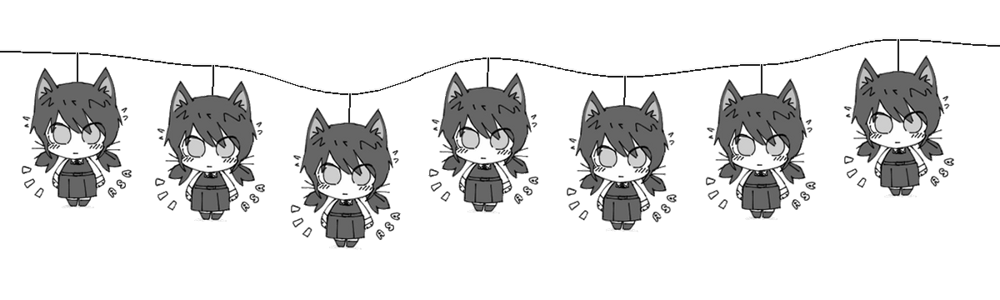

<!-- ===================== W/NTER ===================== -->

<!-- Asa Mitaka — Main Character -->

<!-- W/NTER -->

  

<!-- W/NTER — Biography -->

  

<!-- ===================== SOCIAL BADGES ===================== -->

  
  
  
  

<!-- ===================== TECH STACK ===================== -->

  

<!-- End Asa Floating Area -->
 

<!-- ===================== GITHUB STATISTICS ===================== -->

  <h3>〢 📊 GitHub Statistics</h3>

  <table>
    <tr>
      <td align="center" valign="middle" width="50%">
        
      </td>
      <td align="center" valign="middle" width="50%">
        
      </td>
    </tr>
  </table>

<!-- ===================== PROFILE VIEWS ===================== -->

  

<!-- ===================== ASA CHIBI FOOTER ===================== -->

  

